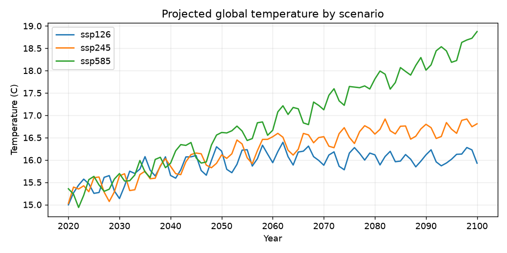
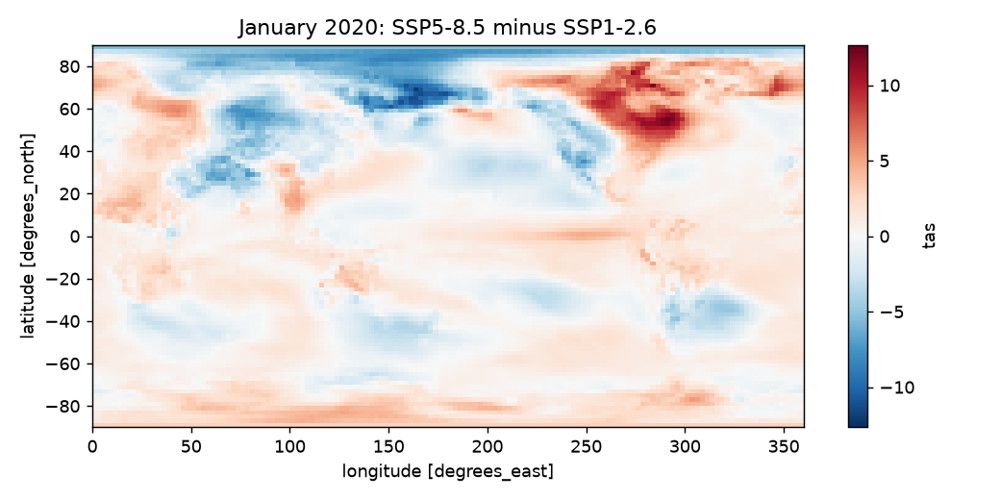
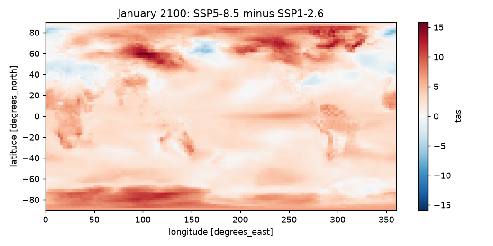
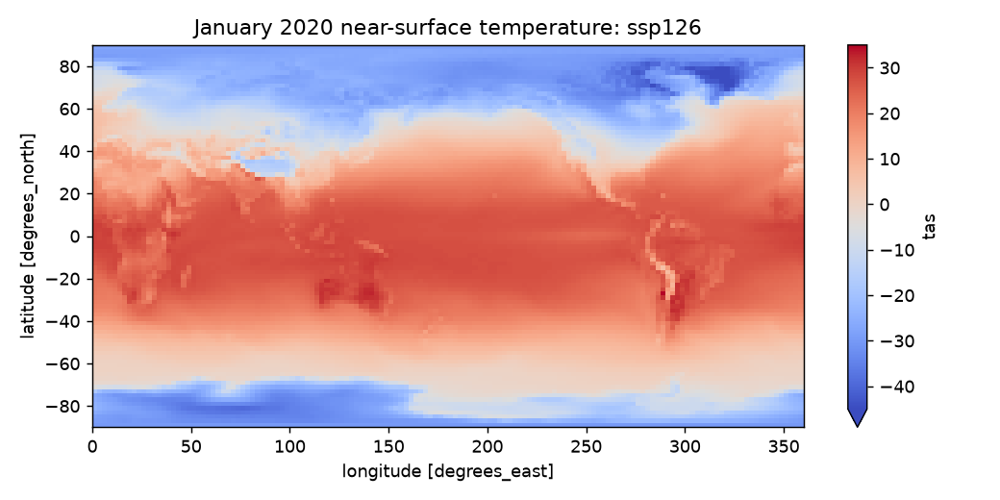
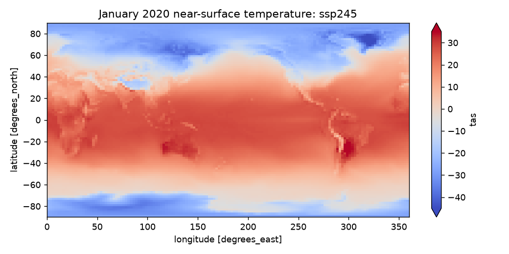
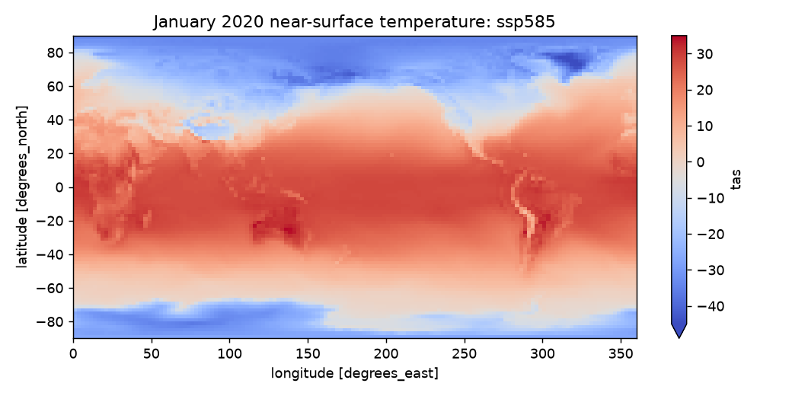

# Final Project Proposal Draft

## Working title

**Two Climate Futures: Where High Emissions Add the Most Heat**

## Team members

- Don Le
- Raynard Taneka
- Krishang Khandelwal

## Dataset

We plan to continue using the CMIP6 climate projections from our Project 3 work. The current data comes from the NASA GISS-E2-1-G model and includes monthly near-surface air temperature under three emissions scenarios: SSP1-2.6, SSP2-4.5, and SSP5-8.5. We are looking at projected temperatures from 2020 through 2100. For the browser version, the large source files are averaged into a smaller latitude-longitude grid and saved as CSV files. This is model projection data, so the values describe possible futures under different emissions assumptions rather than exact forecasts.

## What we intend to do

Our project will explain how the location and amount of future warming changes under different emissions scenarios. We want the reader to begin with the global trend and then explore where the high-emissions future separates most from the low-emissions future. The main map will compare SSP5-8.5 with SSP1-2.6 and let the reader move through years and months. Country outlines, direct hover values, and short annotations will help connect the temperature grid to recognizable places. A second view may compare the three global temperature trends so the map has context. The final page should feel like a short visual story rather than a dashboard with many unrelated controls. One limitation is that the current data uses one climate model, so we will explain that the project shows one model's projections rather than the full uncertainty across CMIP6.

## Static visualization ideas

These are early views from the dataset. The team should choose the strongest five or six for the submitted proposal and revise the captions where marked.

### 1. Global temperature paths under three scenarios

This overview shows when the three scenarios begin to separate. It could become the opening view because it explains why comparing scenarios matters before the reader moves to the map.

### 2. High-emissions minus low-emissions difference in 2020

The early-year comparison is useful as a baseline. The mixed red and blue pattern also shows why a single month should not be treated as a complete long-term climate conclusion.

### 3. High-emissions minus low-emissions difference in 2100

By 2100, the high-emissions scenario is warmer across most of the grid, with especially large differences toward the poles. This is likely the clearest static view for the project's main takeaway.

### 4. Low-emissions scenario baseline

**Caption to finish as a team:** Decide whether this absolute-temperature map adds information beyond the difference maps, or whether it should be replaced with a later-year SSP1-2.6 view.

### 5. Middle-emissions scenario baseline

**Caption to finish as a team:** Explain whether the middle scenario helps tell the story or makes the proposal feel repetitive.

### 6. High-emissions scenario baseline

**Caption to finish as a team:** Compare this view with the low-emissions map and decide whether both should use the same year, month, and color scale.

## Map and interaction direction

- Keep the geographic reference visible with country outlines instead of showing only a rectangular heat grid.
- Use one consistent diverging scale for scenario differences, centered at zero.
- Let the reader play or scrub through years, then pause to inspect a place with a tooltip.
- Add only a few annotations for the largest or most surprising regional differences.

## Work still open for the group

- Select the final five or six static figures and finish captions 4-6.
- Decide whether the middle scenario belongs in the final story.
- Write the exact research question and the final one-sentence takeaway.
- Sketch the order of the explorable explanation and decide where annotations appear.
- Check whether we should include more than one CMIP6 model to discuss uncertainty.
- Divide the prototype, writing, visual design, and video work among the three members.

